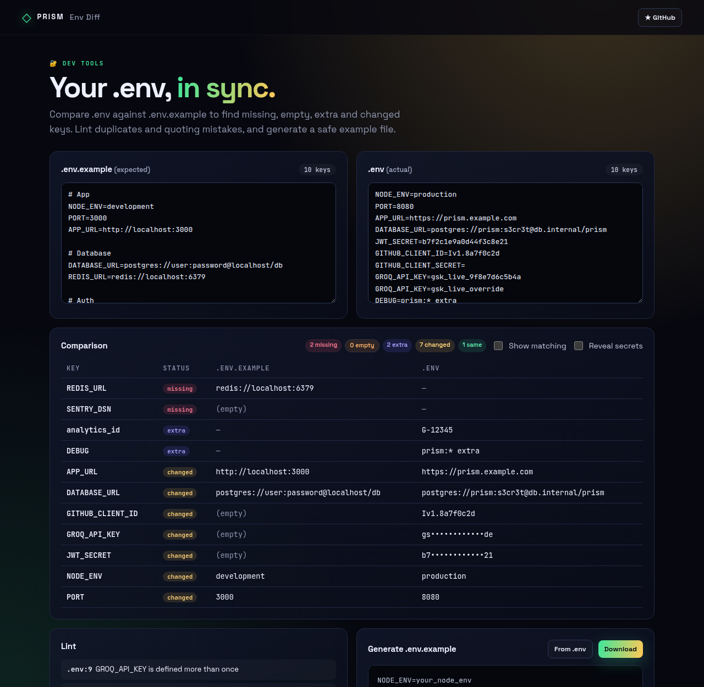
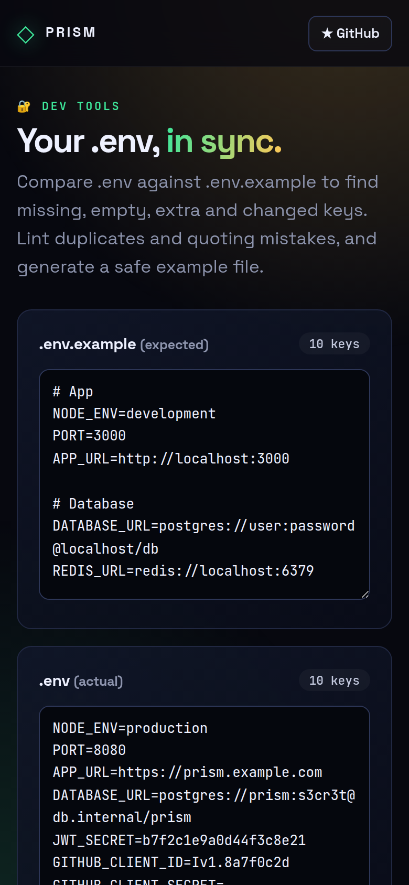

<!-- ═════════════ HEADER ═════════════ -->
<p align="center">
  
</p>

<p align="center">
  
</p>

<p align="center">
  <a href="https://github.com/krishyaa06/prism-env-diff/actions/workflows/ci.yml"></a>
  <a href="https://krishyaa06.github.io/prism-env-diff/"></a>
  
  
  <a href="LICENSE"></a>
</p>

<p align="center">
  
</p>


## ⚡ Overview

**Prism Env Diff** catches the classic "works on my machine" bug: a missing or empty environment variable. Paste the expected `.env.example` and the actual `.env`, and every key is labelled missing, empty, extra, changed or matching. A linter flags duplicates, unclosed quotes, unquoted spaces and odd casing, and a generator turns a real `.env` into a shareable example with secrets removed. Nothing leaves your browser.

## ✨ Features

- **Diff** with statuses: missing, empty, extra, changed, same
- **dotenv-compatible parser** — `export`, single/double quotes, inline comments, multiline values
- **Lint** duplicates, syntax errors, unclosed quotes, unquoted spaces, key casing
- **Secrets masked** by default (keys matching SECRET/TOKEN/KEY/PASSWORD/DSN…)
- **.env.example generator** that blanks secrets and normalises URLs
- Runs locally — values never leave the page

## 📸 Screenshots

<table>
  <tr>
    <td width="68%"></td>
    <td width="32%"></td>
  </tr>
</table>

## 🚀 Quick Start

**Use it online:** [https://krishyaa06.github.io/prism-env-diff/](https://krishyaa06.github.io/prism-env-diff/)

**Run locally:**

```bash
git clone https://github.com/krishyaa06/prism-env-diff.git
cd prism-env-diff
# open index.html in your browser, or serve it:
npx serve .
```

## 🛠️ Usage

1. Paste your `.env.example` on the left and `.env` on the right.
2. Read the comparison table and fix anything **missing** or **empty**.
3. Use **Generate .env.example** to produce a safe template from your real file.

## 📁 Project Structure

```
prism-env-diff/
├── assets/
│   ├── logo.png
│   └── logo.svg
├── css/
│   ├── app.css
│   └── prism.css
├── js/
│   ├── app.js   # UI wiring
│   ├── core.js   # parser, diff, lint, example generator — tested in Node
│   └── prism.js
├── test/
│   └── core.test.js
├── .gitignore
├── LICENSE
├── index.html
└── package.json
```

## 🧪 Tests

```bash
npm test
```

Tests use the built-in `node:test` runner, so there is nothing to install. CI runs them on Node 20 and 22.

## 🤝 Contributing

1. Fork the repo and create a branch: `git checkout -b feature/my-idea`
2. Make your change and add a test in `test/`
3. Run `npm test` and open a Pull Request

## 🔷 Part of Prism Protocol

Prism Env Diff is one of the open-source tools built by [Prism Protocol](https://dc.gg/prismprotocol), a tech community where young builders learn, ship and compete together.

## 👤 Author

<table>
  <tr>
    <td align="center">
      <a href="https://github.com/krishyaa06"><br><b>Soumya Bhandare</b></a><br>
      <sub>Founder @ Prism Protocol</sub>
    </td>
    <td>
      <a href="https://dc.gg/prismprotocol"></a><br>
      <a href="https://instagram.com/prism_protocol_"></a><br>
      <a href="https://x.com/krishyaa06"></a>
    </td>
  </tr>
</table>

## 📄 License

Released under the [MIT License](LICENSE).

<p align="center">
  <b>If you like this project, consider giving it a ⭐</b><br>
  <sub>"Build. Create. Compete." · Made with ⚡ by Prism Protocol</sub>
</p>


